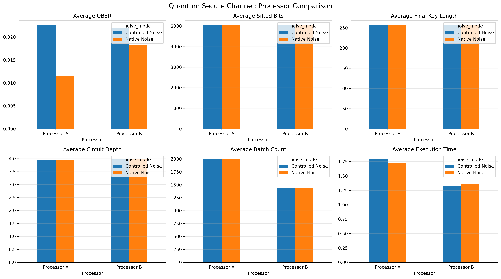

# ⚛️ Quantum Secure Channel
### Because "just send me the password" is not a security protocol.

**BB84 · Qiskit · AES-256-GCM · Quantum Simulation**

> Alice wants to send Bob a message. Eve wants to read it. Quantum mechanics has other plans.

Welcome to **Quantum Secure Channel**, a project exploring how quantum key distribution can help establish a secure communication channel.

We combine the BB84 quantum key distribution protocol with AES-256-GCM encryption, then put two simulated quantum processors head-to-head.

One has 5 qubits. The other has 7.

Both have a job to do. Neither gets to blame the Wi-Fi.

---

## 🧠 1. What are we actually building?

Imagine Alice wants to send Bob a secret message.

Unfortunately, Eve is listening.

Traditional encryption protects the message, but we also need a way for Alice and Bob to establish a shared secret key.

That's where BB84 comes in.

Our project demonstrates a simulated quantum communication workflow in which:

- Alice prepares quantum bits using randomly selected bases.
- Bob measures them using his own randomly selected bases.
- They compare basis choices and keep matching measurements.
- They estimate the Quantum Bit Error Rate (QBER).
- They perform educational error reconciliation and privacy amplification.
- They derive a shared 256-bit key.
- AES-256-GCM takes over and encrypts the actual message.

Quantum mechanics handles the key distribution experiment. Classical cryptography handles the message.

**Eve is not having a particularly productive day.**

## 🎯 2. The Mission

Our selected problem statement: **Quantum Secure Channel**

The objectives are to:

1. Implement the BB84 quantum key distribution protocol.
2. Establish a shared secret key between Alice and Bob.
3. Estimate QBER and monitor errors in the quantum channel.
4. Demonstrate error reconciliation and privacy amplification.
5. Integrate the generated key with AES-256-GCM.
6. Compare two different simulated quantum processor architectures.
7. Analyse execution time, circuit characteristics, batch capacity and key-generation performance.

In short: generate a key, secure a message, and find out which processor does the job better.

## ⚛️ 3. The Tech Stack

| Technology | What it does |
|---|---|
| Python | Makes everything happen |
| Qiskit | Builds quantum circuits |
| Qiskit Aer | Simulates quantum execution |
| NumPy | Handles the mathematics and bits |
| Pandas | Makes sense of experimental data |
| Matplotlib | Turns numbers into graphs |
| Cryptography | Provides AES-256-GCM |
| HMAC | Authenticates the demonstration transcript |

## 🔐 4. How the magic happens

Or, more accurately, how the mathematics happens.

```text
                 ALICE
                   |
          Generate random bits
                   |
          Generate random bases
                   |
           Prepare BB84 qubits
                   |
                   v
          QUANTUM CHANNEL
                   |
            Processor A / B
                   |
                   v
                  BOB
                   |
          Measure received qubits
                   |
                   v
              BASIS SIFTING
                   |
                   v
              QBER ESTIMATION
                   |
                   v
           ERROR RECONCILIATION
                   |
                   v
           PRIVACY AMPLIFICATION
                   |
                   v
             SHARED 256-BIT KEY
                   |
                   v
              AES-256-GCM
                   |
                   v
             ENCRYPTED MESSAGE
                   |
                   v
             BOB DECRYPTS IT
                   |
                   v
             MESSAGE VERIFIED
```

### The BB84 workflow

**Step 1 — Alice gets random**

Alice generates random binary values and random measurement bases.

**Step 2 — Quantum state preparation**

Each bit is encoded using either the computational (Z) basis or the Hadamard (X) basis.

**Step 3 — Transmission**

The circuits are executed using the selected processor configuration and its simulated noise model.

**Step 4 — Bob makes measurements**

Bob independently chooses measurement bases and measures the received quantum states.

**Step 5 — Basis sifting**

Alice and Bob publicly compare their basis choices. Matching bases are retained.

**Step 6 — QBER estimation**

A sample of the sifted bits is compared to estimate the error rate.

**Step 7 — Reconciliation and privacy amplification**

The implementation demonstrates educational error reconciliation followed by Toeplitz hashing.

**Step 8 — Key confirmation**

Alice and Bob verify that their resulting keys match.

And finally, the key gets a job: encrypting the message.

## 🖥️ 5. Meet the contestants

Two processors enter. A collection of random bits leaves.

### Processor A — The 5-Qubit Baseline

| Property | Configuration |
|---|---|
| Qubits | 5 |
| Undirected connections | 4 |
| Single-qubit depolarizing error | 0.0005 |
| Two-qubit depolarizing error | 0.005 |
| Readout error | 1% |
| Role | Lower-noise baseline |

Processor A has a smaller architecture and lower configured noise probabilities.

### Processor B — The 7-Qubit Challenger

| Property | Configuration |
|---|---|
| Qubits | 7 |
| Undirected connections | 6 |
| Single-qubit depolarizing error | 0.001 |
| Two-qubit depolarizing error | 0.01 |
| Readout error | 2% |
| Role | Higher-capacity architecture |

Processor B brings more qubits and more connectivity, but also higher configured noise.

More qubits, more responsibility.

Both processors are implemented using Qiskit's `GenericBackendV2`, with separately configured coupling maps and noise models.

## 🧪 6. The Experiment

We don't just run the protocol once and declare victory.

The comparison uses:

| Parameter | Value |
|---|---:|
| Message transmission bits | 12,000 |
| Comparison bits | 10,000 |
| Trials per configuration | 3 |
| QBER sampling fraction | 20% |
| QBER abort threshold | 11% |
| Final encryption key | 256 bits |

Four configurations are evaluated:

1. Processor A — Controlled Noise
2. Processor A — Native Noise
3. Processor B — Controlled Noise
4. Processor B — Native Noise

Three trials per configuration.

That's 12 opportunities for the processors to prove themselves.

## 📊 7. The Results Are In

### Message delivery

| Metric | Processor A | Processor B |
|---|---:|---:|
| Qubits | 5 | 7 |
| QBER | 0.9136% | 1.6239% |
| Sifted bits | 6,023 | 5,853 |
| Corrected errors | 52 | 107 |
| Final key | 256 bits | 256 bits |
| Execution time | 2.151 s | 1.976 s |
| Message delivery | SUCCESS | SUCCESS |
| Key confirmation | PASSED | PASSED |
| Authentication | PASSED | PASSED |

**The message made it. Both times.**

Original message and receiver's decrypted message matched for both processors.

### Processor showdown

| Processor | Noise Mode | Average QBER | Execution Time |
|---|---|---:|---:|
| A | Controlled Noise | 2.2526% | 1.796 s |
| A | Native Noise | 1.1600% | 1.719 s |
| B | Controlled Noise | 2.1893% | 1.325 s |
| B | Native Noise | 1.8231% | 1.358 s |

### The scoreboard

- **12/12** successful comparison trials.
- **0** failed comparison trials.
- **2/2** successful message deliveries.
- **256 bits** of final encryption key for each successful message session.

### Experimental Dashboard




### What did we learn?

**Processor A:** Lower QBER in the native-noise comparison and in the message transmission run.

**Processor B:** Faster execution in both comparison configurations.

Processor B's higher capacity allows it to process seven independent circuits per batch instead of five.

For 10,000 comparison bits:

- Processor A: 2,000 batches.
- Processor B: 1,429 batches.

That's approximately **28.55% fewer batches** for Processor B.

The takeaway?

More qubits can improve processing capacity, but more qubits do not automatically mean lower error rates.

Quantum computing: where bigger isn't always better.

## 📁 8. Repository Structure

```text
Quantum-Secure-Channel/
│
├── README.md
├── requirements.txt
├── main.ipynb
│
├── processors/
│   ├── __init__.py
│   └── hardware.py
├── src/
│   └── qkd.py
└── results/
    ├── security_report.json
    │
    ├── figures/
    │   ├── qber_comparison.png
    │   ├── sifted_bits_comparison.png
    │   ├── final_key_length_comparison.png
    │   ├── circuit_depth_comparison.png
    │   ├── gate_count_comparison.png
    │   ├── batch_count_comparison.png
    │   ├── corrected_errors_comparison.png
    │   └── processor_dashboard.png
    │
    └── tables/
        ├── message_delivery_results.csv
        ├── message_session_summary.csv
        ├── processor_trial_data.csv
        ├── processor_trial_failures.csv
        ├── processor_summary.csv
        └── architecture_summary.csv
```

## 📈 9. What gets generated?

The experiment automatically produces:

**Visualisations**
- QBER comparison
- Sifted bits comparison
- Final key length comparison
- Circuit depth comparison
- Gate count comparison
- Batch count comparison
- Corrected errors comparison
- Processor dashboard

**CSV datasets**
- Message delivery results
- Message session summary
- Processor trial data
- Processor trial failures
- Processor summary
- Architecture summary

**Security report**
- `security_report.json`

Because screenshots are nice, but reproducible data is nicer.

## ⚙️ 10. Installation and Execution

### Clone the repository

```bash
git clone https://github.com/rohanthapliyal07-ops/quantum-bb84-channel.git
cd quantum-bb84-channel
```

### Create a virtual environment

```bash
python -m venv .venv
```

Activate it:

**Windows**
```bash
.venv\Scripts\activate
```

**Linux / macOS**
```bash
source .venv/bin/activate
```

### Install dependencies

```bash
pip install -r requirements.txt
```

### Launch the notebook

```bash
jupyter notebook main.ipynb
```

Run the notebook cells in order.

The experiment will generate the result files in the `results/` directory.

## ⚠️ 11. Reality Check: Limitations

Quantum security is serious business, so let's be honest about what this project does and doesn't demonstrate.

- This is a simulation, not a deployment on physical quantum hardware.
- The BB84 implementation uses independent single-qubit circuits.
- Although the processors have different coupling maps, the current BB84 workload does not exercise two-qubit connectivity.
- Error reconciliation is an educational demonstration, not a complete implementation of a standard protocol such as Cascade.
- The key-length calculation is heuristic, not a composable finite-key security proof.
- The noise models are simplified configurations, not complete hardware calibration data.
- The local demonstration authentication key is not a complete real-world authenticated key exchange system.

**Important:** This project demonstrates a quantum-assisted communication workflow. It does not claim to provide production-grade quantum security.

## 🚀 12. Future Improvements

There is plenty more to explore:

- Implement standard error reconciliation.
- Introduce rigorous finite-key security analysis.
- Test the system on actual quantum hardware.
- Add connectivity-aware multi-qubit benchmarks.
- Explore more realistic hardware noise models.
- Compare additional processor architectures.
- Investigate integration with post-quantum cryptographic algorithms.

The quantum rabbit hole is deeper than it looks.

## 🏁 13. Final Thoughts

We started with a simple question:

**Can we use quantum key distribution to establish a shared secret and use it to secure a message?**

Our simulation demonstrates an end-to-end workflow that combines BB84, privacy amplification, key confirmation, and AES-256-GCM.

Both processor architectures completed all comparison trials, and both successfully delivered the encrypted message.

Processor A showed lower QBER in the native-noise experiment, while Processor B demonstrated better execution efficiency.

No physical quantum computers were harmed in the making of this project.

---


## 🤖 14. AI Assistance Disclosure

AI tools were used as development assistance for understanding quantum computing concepts, explaining and debugging code, and preparing project documentation.

The project team is responsible for reviewing, understanding, testing, and presenting the implementation and experimental results.

---

**Built with Python, Qiskit, cryptography, and a healthy respect for quantum mechanics.**

*If Eve is reading this README, she still doesn't have the key.*
